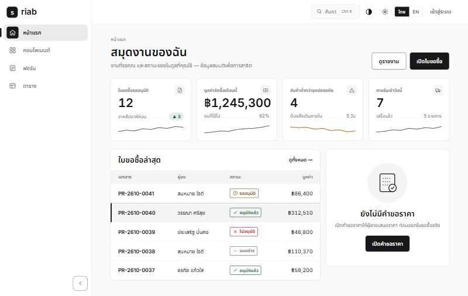
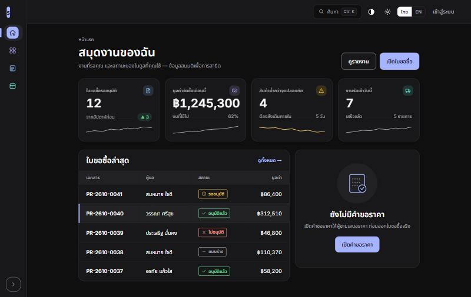

# riab

A free, themeable React UI starter. White, quiet, neat: "riab" is Thai for _neat_.

Ink-on-white minimal identity, design tokens with dark mode, Thai-first typography, Thai/English out of the box, a user-facing **Customize** panel, and 21 accessible components. Vite + React + TypeScript, no runtime dependencies beyond React. MIT licensed.

**Live demo:** https://littihai.github.io/riab/

|                                   Sidebar, light                                   |                      Icon rail, dark, indigo, color icons                      |
| :--------------------------------------------------------------------------------: | :----------------------------------------------------------------------------: |
|  |  |

## What you get

- **Tokens, not magic numbers.** One file (`src/styles/tokens.css`) holds every color, radius, shadow, duration and type size. Retheme by editing it.
- **Light and dark** that follow the system or the user's choice, with every text pair measured against WCAG 4.5:1 (a test does the measuring, for every accent, in both modes).
- **Customize panel:** five accent colors, three corner styles, two densities, mono or colored icons, one reduced-motion switch, and three navigation layouts (top bar, sidebar, icon rail). Choices persist and apply before first paint.
- **Thai-first:** Inter + Noto Sans Thai (bundled, no font CDN), Thai-safe sizes and line heights, Thai and English text for every string, one date and money formatter per language.
- **21 components** with keyboard support and written accessibility notes: see [docs](docs/README.md).
- **Ctrl K command palette**, **skip link**, **toasts** with tones and a close button.
- **Quality gates:** TypeScript strict, ESLint (including jsx-a11y), Prettier, and a Vitest suite that covers keyboard behavior, contrast, house rules and an axe pass over every demo page.

## Start

Click **Use this template** on GitHub (or clone), then:

```bash
npm ci
npm run dev          # http://localhost:5280
```

Node 20 or newer.

### Make it yours

1. **Delete what is ours:** `src/demo/` is the demo site (shell, pages, palette, settings). Your app replaces it, but you may keep `Shell.tsx`, `SideNav.tsx`, `CmdK.tsx` and `SettingsDialog.tsx` as a starting point. Also delete `mockup/`, `docs/STATUS.md`, `docs/img/`, `public/og.jpg`, `CHANGELOG.md` entries, and `CLAUDE.md` (our working notes; keep it only if you adapt it to your own rules).
2. **Keep the parts that matter:** `src/components/ui/`, `src/hooks/`, `src/providers/`, `src/i18n/`, `src/styles/`, `src/test/`.
3. **Rename:** `name`, `description`, `repository`, `homepage` and `bugs` in `package.json`; `<title>`, description and the `og:` tags in `index.html`; `public/favicon.svg`; the `base` path for GitHub Pages (`build:pages` in `package.json`).
4. **Retheme:** edit `src/styles/tokens.css` (see [tokens](docs/tokens.md)), then `npm test` to check contrast.
5. **Own your strings:** edit `src/i18n/dict.ts`.

## Scripts

| Command               | What it does                                     |
| --------------------- | ------------------------------------------------ |
| `npm run dev`         | Dev server on port 5280                          |
| `npm run build`       | Typecheck and production build to `dist/`        |
| `npm run build:pages` | Build with `--base=/riab/` for GitHub Pages      |
| `npm run typecheck`   | `tsc` without emitting                           |
| `npm run lint`        | ESLint (react-hooks, jsx-a11y, no inline styles) |
| `npm run format`      | Prettier write (`format:check` to verify)        |
| `npm test`            | Vitest: keyboard, contrast, house rules, axe     |

## What is inside

| Area       | Files                   | Notes                                                                                             |
| ---------- | ----------------------- | ------------------------------------------------------------------------------------------------- |
| Tokens     | `src/styles/tokens.css` | Colors (three-layer accent), type scale, radii, shadows, motion, density. [Guide](docs/tokens.md) |
| Base       | `src/styles/base.css`   | Reset, typography, the Thai rules, entrance animation.                                            |
| Components | `src/components/ui/`    | Each documented in [docs/components](docs/README.md).                                             |
| Hooks      | `src/hooks/`            | Focus trap, dismissal, placement, media query. [Guide](docs/hooks.md)                             |
| Providers  | `src/providers/`        | Theme, Appearance (Customize), I18n.                                                              |
| i18n       | `src/i18n/dict.ts`      | Every visible string, Thai and English, keys checked by the compiler.                             |
| Demo       | `src/demo/`             | Dashboard, gallery, form, table, sign-in, 404, with a small hash router in `App.tsx`.             |
| Tests      | `src/**/*.test.ts(x)`   | Behavior, contrast, house rules, axe.                                                             |

## House rules (what keeps it neat)

- **Tokens only.** No inline styles, no hex values outside `tokens.css`. Lint and a test enforce it.
- **Three-layer accent.** `--accent-fill`, `--on-accent`, `--accent-text`, never one color for everything.
- **One of each.** One toast channel (`aria-live`), one dialog style, one date and one money formatter per language.
- **Thai typography.** Content at 14px or more (12px only through `--fs-micro`), body line-height 1.55 or more, no letter-spacing or uppercase on Thai.
- **Both modes always.** Every text pair passes 4.5:1 in light and dark; status is never color alone (icon plus text); control edges use `--border-strong` (3:1).
- **Motion with an off switch.** Every duration reads `--dur-*`; the OS reduced-motion flag or `data-motion="reduce"` stops all of it.
- **User choices live under `riab.*`** in localStorage, and the pre-paint script in `index.html` knows each one.

## Accessibility

Automated checks (axe over every demo page in Thai and English, contrast for every token pair, keyboard tests for dialogs, tabs, menu, palette and sidebar) run with `npm test`. They catch structure and contrast problems, but they are not a substitute for trying your own pages with a screen reader and a keyboard. Known gaps are tracked in [docs/STATUS.md](docs/STATUS.md).

## Deploying the demo (GitHub Pages)

```bash
npm run build:pages
```

Publish `dist/` to the `gh-pages` branch (or use the workflow in `.github/workflows/pages.yml`) and point Pages at it. Fonts are bundled, so the demo works offline.

## Contributing

Issues and pull requests are welcome: see [CONTRIBUTING.md](CONTRIBUTING.md). Report security problems as described in [SECURITY.md](SECURITY.md). Release notes are in [CHANGELOG.md](CHANGELOG.md).

## License

MIT, see [LICENSE](LICENSE). Inter and Noto Sans Thai are licensed under the SIL Open Font License (bundled through Fontsource).
